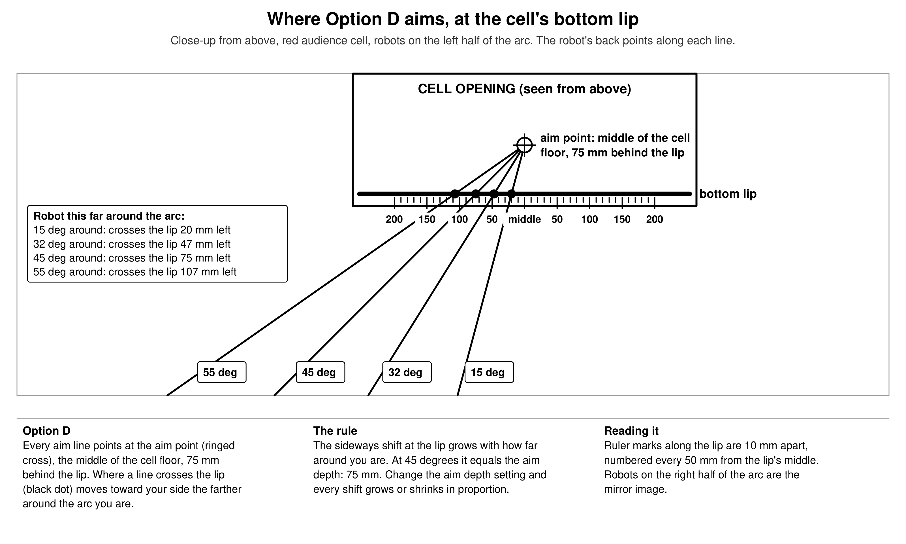
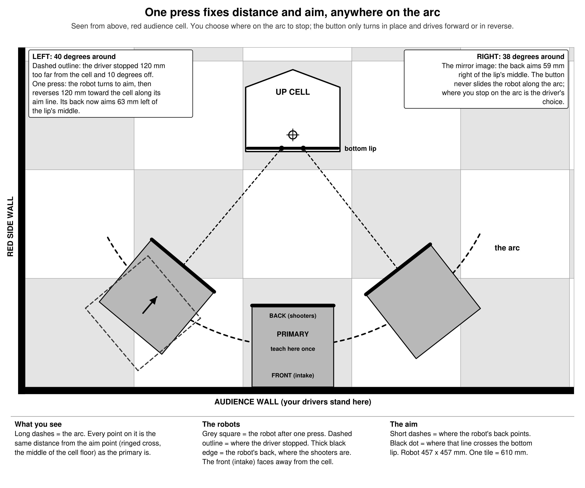
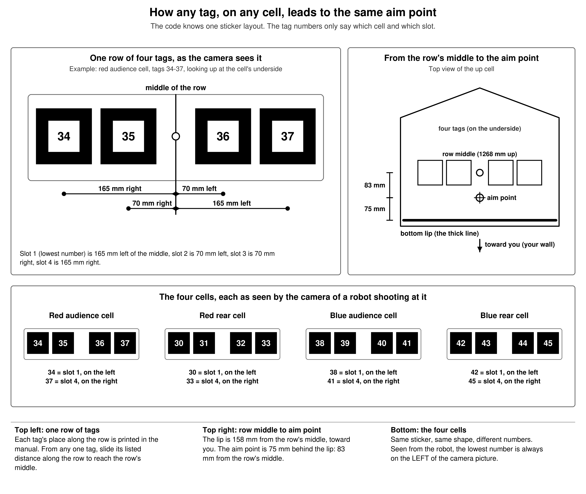
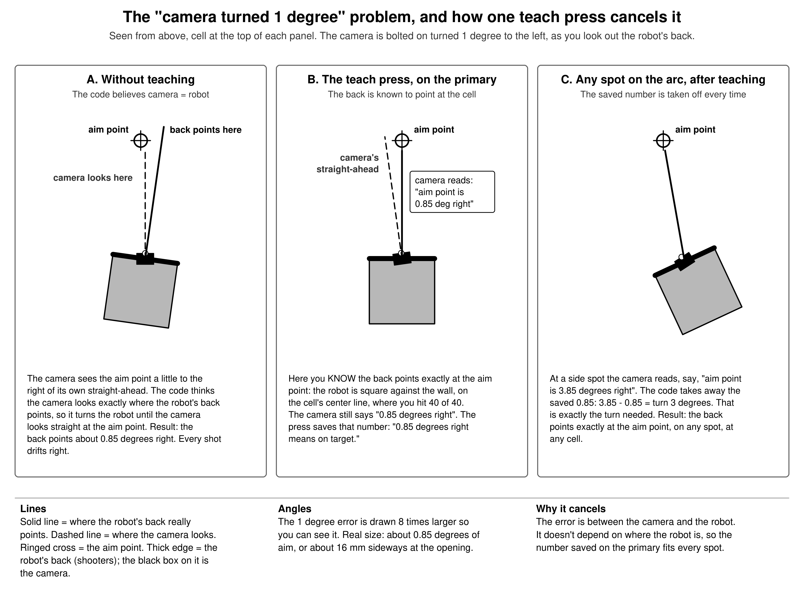
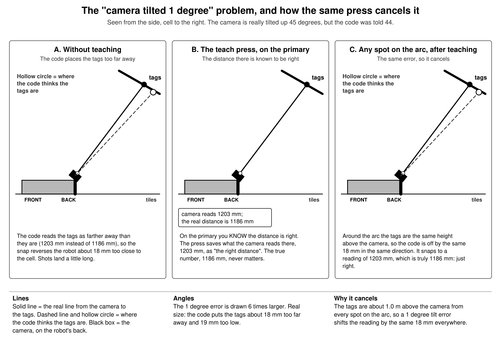
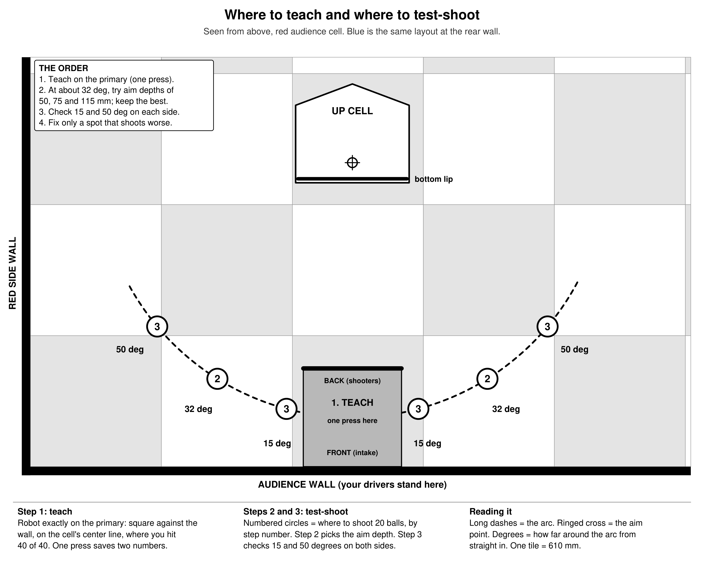

# Snap-to-Shooting-Position Button: Option D, With Everything Needed to Build It

Date: 2026-10-27 (this version written 2026-10-29)

- **Changes from V04:**
    - Option C is removed. Option D is the only aim, so the `OPTION_D` switch and the Option C settings are gone.
    - The robot's **front is the intake side** and its **back is the shooter side**, in the text, the figures and the code. When the robot shoots, its back faces the cell, so getting closer to the cell means driving in **reverse**.
    - All measurements are metric: millimetres (mm) and degrees, in the text, the code and the setting names.
    - The figures are redrawn for black-and-white printing, with larger text and plain white backgrounds. The only shading is on the field views: alternate tiles are light grey and the robots are grey.
    - The "angle app" is explained in section 5.2. V04 also gave the wrong instruction for it: a phone laid on the camera's flat back reads 90 minus the tilt, not the tilt.
    - "Wheel power" in the settings table is now called **motor power** and explained (section 5.3).
- **Builds on:** `2026-10-27-Optimal-Secondary-Shooting-Positions-V02.md` (where the good spots are) and `2026-10-27-TeleOp-Drive-To-Spot-Button-V01.md` (camera mount and visibility).
- **Status:** design only. Nothing has been built. The code in section 5 is written against the TeleOp copy in this folder, which is older than your live TeleOp; merge it into the live file.

## The short answer

**Build one snap button using Option D.** Hold the button, and in about a second the robot:

- turns in place until its back (the shooters) points at the middle of the cell floor, 75 mm behind the cell's bottom lip
- drives straight forward or in reverse until it is the same distance from that point as it is on the primary

It never slides sideways along the arc, so the driver still picks where to stop.

**Setup work:**

- One teach press on the primary. It covers all four cells and both alliance colors.
- One aim setting (`AIM_DEPTH_MM`), picked by shooting.
- About 160 test balls in total.

**The three things you asked to have explained:**

- **The four tags on each cell need no separate tuning.** All four cells carry the same sticker. The code only uses each tag's slot in the row (1 to 4), never where the cell is on the field. See section 3 and Figure 6.
- **"1 degree off":** the code has to be told exactly how the camera sits on the robot, and a tape-measure setup is always a little off. One teach press on the primary measures that error and takes it off everywhere. See section 4 and Figures 4 and 5.
- **Motor power** (the old table's "wheel power") is the number from 0 to 1 that the program sends to each drive motor. 0.40 means 40 percent of full power. See section 5.3.

**Words used for directions, everywhere in this report and in the code:**

| Word | Meaning |
|---|---|
| Front | The intake side of the robot |
| Back | The shooter side. The camera is mounted here. |
| Forward | Driving front first |
| Reverse | Driving back first. When shooting, reverse moves the robot toward the cell. |
| The robot's left / right | The robot's own left and right when facing its front. Standing behind the shooters looking at the cell, the robot's left is on your right. |
| Left / right of the arc or the lip | As your drivers see it, standing at the wall looking at the cell |
| Counter-clockwise | Turning as seen from above. The code's turn numbers are + for counter-clockwise. |

## 1. Option D: where the robot aims



**The distance part.** The robot stays the same distance from the aim point as it is on the primary: about 1186 mm from the robot's center. Every spot at that distance forms a curve around the cell, called **the arc** in this report.

**The aim part.** The robot's back always points at one fixed point: the middle of the cell floor, `AIM_DEPTH_MM` (75 mm) behind the bottom lip. This is the **aim point**.

- On the primary, the robot is straight in, so it aims at the middle of the lip.
- From the side, the line to the aim point crosses the lip a little toward your side. The farther around the arc you are, the bigger that shift.
- At 45 degrees around, the shift equals the aim depth. Change the aim depth, and every shift grows or shrinks in proportion.

**Where the aim line crosses the bottom lip,** in mm toward your side of the lip's middle:

| Aim depth setting | 15 degrees around | 32 degrees (regular secondary spot) | 45 degrees | 55 degrees |
|---|---|---|---|---|
| 50 mm | 13 | 31 | 50 | 71 |
| **75 mm (start here)** | **20** | **47** | **75** | **107** |
| 115 mm | 31 | 72 | 115 | 164 |

Shooting picks the setting (section 6, step 2).

## 2. What the button does



**The driver:**

1. Drives to roughly the right place on the arc, with the back (shooters) facing the cell, and slows down.
2. Holds the snap button (suggested: driver's right trigger).
3. Waits for the rumble, which comes in about 1 second, then shoots.

**The driver can take over at any moment** by letting go or touching a drive stick.

**What happens during one press:**

1. **Wait until still.** The Pinpoint must read under 25 mm per second and 5 degrees per second. The Pinpoint is the odometry computer with the two small tracking wheels. A camera on a moving robot gives smeared readings.
2. **Read the camera.** The program takes 5 fresh readings, which takes about 0.1-0.2 s, and averages two numbers:
    - the distance from the robot's center to the aim point
    - how many degrees the robot must turn so its back points at the aim point
3. **Check the start limits.** The button refuses with two short rumbles, and the telemetry screen says why, when:
    - fewer than 2 tags are seen
    - the robot is more than 150 mm off the right distance
    - the robot needs more than a 15 degree turn
    - the robot is more than 60 degrees around the arc
4. **Move.** The robot turns in place by the measured amount, then drives straight by the distance error, steering on the Pinpoint.
    - Too far from the cell: it drives in reverse. Too close: it drives forward.
    - The goal lies on the line from the robot to the aim point, so the robot moves toward or away from the cell, never along the arc.
5. **Look again.** The robot stops and takes another camera reading. If it is still more than 20 mm or 1 degree off, it makes one more small move.
6. **Rumble:** ready to shoot.

**Why the camera measures and the Pinpoint steers:** the camera gives a new reading only 20-50 times a second. Each reading is a little late, and it blurs if the robot moves. The Pinpoint updates every program loop. So the camera says where to go, and the Pinpoint gets the robot there.

## 3. How the robot uses the four tags on each cell, without retuning



### What the camera actually reports

An AprilTag is one of the printed black-and-white squares. The Limelight 3A is the camera; it has its own small computer that finds and measures the tags.

For every AprilTag it sees, the Limelight reports three distances, in mm, in its own directions:

- how far to the **right** of the camera's center line the tag is
- how far **down**
- how far **out** in front of the lens

These come from `getTargetPoseCameraSpace()` in the FTC software. The program never sees a picture. It gets only these numbers, for each tag, about 50 times a second.

### Every cell carries the same sticker

The manual (TU06, Figures 9-15 to 9-17) puts one identical sticker on the underside of every cell:

- four tags in one row, each 82.55 mm square
- tag middles 165 mm and 70 mm either side of the row's middle (exactly 165.1 and 69.85)
- all four flat on the same surface, at the same tilt, 1268 mm above the tiles

Only the printed numbers change:

| Cell | Tag numbers |
|---|---|
| Red audience | 34-37 |
| Red rear | 30-33 |
| Blue audience | 38-41 |
| Blue rear | 42-45 |

**Seen from a robot shooting at a cell, the lowest number is always on the left of the camera picture.** For red audience that's 34, 35, 36, 37 from left to right. This follows from how the manual says to mount the sticker: its bottom edge faces the middle of the field.

So the code needs only one small rule to turn any tag number into its slot:

- **Slot** = (tag number - 30), divided by 4, keep the remainder, plus 1.
    - Example: 36 - 30 = 6. 6 divided by 4 leaves 2. Plus 1 gives slot 3.
    - Example: 42 - 30 = 12, which leaves 0, so slot 1.
- **Which cell** = (tag number - 30) divided by 4, ignoring the remainder: 0 red rear, 1 red audience, 2 blue audience, 3 blue rear.
    - The code uses this only to make sure all the tags it combines come from the same cell, and that the cell belongs to your alliance.

### From the tags to the aim point, step by step

The code works in the robot's own directions: **front**, **left** and **up**, measured from the robot's center.

1. **Turn each tag's camera numbers into the robot's directions.**
    - The code adds the camera's position on the robot and undoes its 44 degree tilt (section 5.4, the three lines marked "camera to robot").
    - The camera looks out the back, so "out of the lens" is toward the robot's back, and the picture's right is the robot's left. The code accounts for both.
    - Now each tag has a position measured from the robot's center.
2. **Find the middle of the row.** Each tag knows its slot, and each slot is a known distance from the row's middle:
    - slot 1 is 165 mm left
    - slot 2 is 70 mm left
    - slot 3 is 70 mm right
    - slot 4 is 165 mm right

   With all four tags, the middle is simply the average of their positions. With two or three tags, the code fits a straight line through them, using each tag's known offset; that gives both the row's middle and the direction the row runs. Any two tags work: in the model, every combination (two neighbors, the two outer ones, three, or four) gives the same answer.
3. **Find the aim point.** Seen from above, the bottom lip of the opening is 158 mm from the row's middle, toward you. The aim point is `AIM_DEPTH_MM` (75 mm) behind the lip, so 83 mm from the row's middle toward you. "Toward you" means straight across the row, which the code knows from step 2.
4. **Two numbers come out:**
    - the distance from the robot's center to the aim point
    - the turn that makes the robot's back point at the aim point

### Why nothing has to be retuned for another cell

- **Nothing in the math depends on where the cell is on the field.** Every step above measures from the sticker itself: its slots, its middle, its lip. The four cells have the same shape, so the same numbers fit all of them.
- **The tag numbers only choose the slot.** Tag 30 and tag 42 both mean "slot 1, 165 mm left of the middle".
- **The teach press is about the robot, not the cell** (section 4).
    - The model taught once on the red audience primary, with several mount errors at once.
    - It then snapped on all four cells, at 0 to 50 degrees around on both sides.
    - Every cell came out within 0.6 mm and 0.06 degrees, the same answer on every cell.
- **No field map is needed.** A field map is a file telling the Limelight where every tag is on the field, so it can work out where the robot is on the field. This button never needs a field position, only the robot's position relative to the cell behind it. Limelight hasn't published a BIOBUZZ field map yet anyway.

### What the tags also tell the driver

- **A cell that is down shows no tags.** Its sticker faces away. The button then refuses with "no tags (cell down?)", which doubles as a warning that the cell isn't up.
- **Only your alliance's tags are used.** The code takes the alliance color from the TeleOp's existing "our color" setting (gamepad2 Start in the folder copy).

## 4. The "1 degree off" problem, and how one teach press solves it

### The problem

The camera measures everything **from itself**. The robot needs it measured **from its own center and its own back**. To convert, the code is told how the camera sits on the robot, in four numbers:

- how far behind the robot's center the lens is
- how far to the side
- how high
- how far it is tilted up

**These four numbers are never exactly right.** They come from a tape measure and a phone level app (section 5.2), and a bracket can sit a degree off when it's bolted down. The code also assumes the camera points exactly straight out the back, never turned a little left or right. Every one of these small mistakes turns into a wrong distance or a wrong aim.

### Example 1: the camera turned 1 degree sideways



**What goes wrong (panel A):**

- Say the camera is bolted on turned 1 degree to the left, as you look out the robot's back.
- With the back pointed exactly at the aim point, the camera sees the aim point 1 degree to the right of its own center line.
- The code assumes the camera points where the back points. So it decides the robot is aimed 1 degree left, and turns it to the right.
- Result: the back ends up aimed about 0.85 degrees right, about 16 mm sideways at the opening, and every shot drifts that way.

**How the teach press fixes it (panel B):** on the primary you *know* the back points exactly at the aim point. The robot is square against the wall, on the cell's center line, at the spot where you hit 40 of 40. The camera still says "0.85 degrees right", and the press saves that number as the meaning of "on target".

**Why it works everywhere (panel C):** at a side spot the camera might read "3.85 degrees right". The code takes off the saved 0.85 and turns 3 degrees, which is exactly the turn needed. The error lives between the camera and the robot, so it is the same wherever the robot is.

### Example 2: the camera tilted 1 degree too far up



**What goes wrong (panel A):**

- Say the camera really tilts up 45 degrees, but the code was told 44.
- The tags are about 1 m (1013 mm) above the camera. A 1 degree mistake in tilt swings their computed position by about 1013 mm divided by 57, which is about 18 mm.
- So the code thinks the tags are 18 mm farther away than they are.
- The snap then reverses the robot 18 mm too close to the cell, and shots land a little long.

**How the teach press fixes it (panel B):** on the primary the distance is known to be right. The camera reads 1203 mm where the truth is 1186 mm. The press saves 1203 as "the right distance". The true number never matters.

**Why it works everywhere (panel C):** around the arc the tags are always about 1 m above the camera, so the tilt mistake is always about the same 18 mm. When the code snaps to a reading of 1203 mm, the robot is truly at 1186 mm.

### All the mount errors, before and after teaching

These numbers come from the model (`snapmath.py`). It runs the exact math from section 5 on a simulated camera that is mounted wrong. They are the worst errors seen at 0, 15, 32 and 50 degrees around on one side and 32 degrees on the other:

| How the camera is off | Without teaching: distance | Without teaching: aim | After one teach press |
|---|---|---|---|
| Turned 1 degree sideways | 0 mm | 0.85 deg | 0 |
| Tilted 1 degree more than the code thinks | 17.5 mm | 0 | 0 |
| Rotated 1 degree around its lens | 0 mm | 0.03 deg | 0 |
| 10 mm to one side of where the code thinks | 0 mm | 0.48 deg | 0 |
| 10 mm farther back than the code thinks | 10 mm | 0 | 0 |
| Measures 2% long (tag size or lens setting) | 22 mm | 0.06 deg | 0.6 mm, 0.06 deg |
| **All of the above at once** | **29 mm** | **1.4 deg** | **0.6 mm, 0.06 deg** |

- **What the "all at once" error would cost:** roughly 4-5 points of hit rate in the simulation. A point here means one percentage point, for example 80% down to 76%.
    - A camera bolted on by eye is often 2-3 times further off than this, so the loss could be worse.
    - After the teach press it's essentially zero.
- **The one fact behind every row:** on the arc the robot is always in the same position relative to the aim point. It's always the same distance away, with its back pointed at it. Every spot on the arc is just the primary, swung around the aim point.
    - So any error that belongs to the robot looks the same from every spot on the arc, and the number saved on the primary fits all of them.
    - It fits every cell too, because every cell has the same shape.

### What the teach press does *not* fix

- **Errors in the camera's own measurement that change with viewing angle.** At 50 degrees around, the tags are seen at a slant and sit nearer the edge of the picture than at the primary. Any small error the camera makes there isn't present on the primary, so it isn't canceled. Section 6, step 3 checks for this by shooting.
- **A cell that settles differently after each tip.** The drive-to-spot report's hive rest check (test 3) measures this.
- **Shooter problems:** speed drift, early firing.

### Two built-in checks for big mistakes

The Snap Teach screen (section 5.5) shows two extra numbers that catch large setup mistakes before you rely on the teach press:

- **Tag height** should read about 1268 mm. Each degree of wrong tilt moves it about 19 mm.
    - If it reads low, the camera is tilted up more than `CAM_PITCH_DEG` says, so raise the setting. If it reads high, lower it.
    - Example: reading 1230 means about 2 degrees more tilt.
- **Row length** should read 0.97-1.03. If it doesn't, the tag size setting in the Limelight is wrong. It must be 82.55 mm.

## 5. Building it

### 5.1 Hardware and the Limelight setup

**Camera:**

- Limelight 3A on the **back** of the robot (the shooter side), looking backward and up at the cell.
- Mount it centered if you can, about 255 mm up, tilted up about 44 degrees. Anything from 30 to 56 degrees sees the tags (see the drive-to-spot report).
- Plug it into the Control Hub's blue USB 3.0 port. It draws about 4 W (Limelight power review).
- In the robot configuration it appears as a Limelight device; name it `limelight`.

**Limelight pipeline,** set up in the Limelight's web page as pipeline 0. A pipeline is one saved camera setup.

- Type: AprilTag (fiducial markers).
- Tag family: 36h11. Tag size: 82.55 mm.
- Resolution: 640 x 480, which runs at about 50 readings a second.
    - If readings jump more than 10 mm between frames while the robot sits still, try 1280 x 960 (about 20 a second).
- Leave the ID filter empty, since the code does the filtering.
- If the pipeline's Advanced tab has a "Full 3D" switch, turn it on. The per-tag positions the code reads need it. If Snap Teach shows every tag position as 0, this is the switch to look for.
- If the camera is mounted upside down, use the Limelight's orientation setting so the picture is upright. The code assumes an upright picture.

**Pinpoint:** use the one already on the robot.

- Pedro Pathing sets it up for the autonomous in `pedroPathing\Constants.java`.
- The TeleOp has to set it up the same way: same configuration name, same pod offsets, same pod type, same directions. Copy those values from that file.
- The Pinpoint's X direction must be the robot's front. Bench check 4 in section 5.7 confirms it.

### 5.2 Measure the camera mount

Measure all of these with the robot sitting on the tiles, from the robot's **center** (the point it turns around):

| Setting | What to measure | Starting value |
|---|---|---|
| `CAM_BACK_MM` | From the robot's center to the lens, toward the back | 180 |
| `CAM_LEFT_MM` | Sideways from the center line to the lens. + if the lens is toward the robot's left side. | 0 |
| `CAM_UP_MM` | Lens height above the tiles | 255 |
| `CAM_PITCH_DEG` | How far the camera is tilted up from level | 44 |

**For `CAM_LEFT_MM`, remember** that the robot's left is its own left when facing its front. Standing behind the shooters and looking at the camera, the robot's left is on **your right**.

**Measuring the tilt with a phone level app.** A phone level app is a free app that uses the phone's built-in tilt sensor to show how many degrees the phone is tipped from level.

- **iPhone:** it is built in. Open the **Measure** app and tap **Level** at the bottom.
- **Android:** install any app called "bubble level" or "inclinometer" from the Play Store.

The simplest way to use it on the Limelight 3A:

1. Hold the phone flat against the camera's **back face**, the large flat side opposite the lens.
2. Read the angle. That face leans back from straight up by the same amount the lens tilts up from level.
3. **Camera tilt = 90 minus the reading.** Example: a reading of 46 means the camera tilts up 44 degrees.

Two other ways work too. If the camera is bolted flat to a bracket plate that is square to the lens, the same "90 minus" rule applies to the plate. A plastic protractor held against the camera's side gives the angle directly.

Get the four numbers within about 10 mm and a couple of degrees. The teach press cancels what's left, and the tag height check (section 4) shows if the tilt is badly off.

### 5.3 All the settings in one place

**Motor power,** used in the table below, is the number the program sends to each drive motor with `setPower()`. It runs from 0 (stopped) to 1 (full power), and a minus sign means the motor runs backward. 0.40 means 40 percent of full power. The power settings below are the limits the snap uses while it is driving the robot.

| Setting | Start | What it does | Tune by |
|---|---|---|---|
| `AIM_DEPTH_MM` | 75 | The aim point is this far behind the lip | Shooting (step 2): try 50, 75 and 115 |
| `ARC_DIST_TRIM_MM` | 0 | + = stop farther from the cell than the primary, - = closer | Shooting (step 3), if side spots land long or short |
| `ARC_MAX_POWER` | 0.40 | Highest motor power while snapping | Lower if it overshoots |
| `ARC_MIN_POWER` | 0.08 | Lowest motor power, so it doesn't stall just short of the goal | Raise if it creeps or stalls |
| `ARC_KP_DRIVE` | 0.003 | Motor power per mm of distance still to go. 0.003 means 100 mm to go gives 0.30. | Raise if slow, lower if it wobbles |
| `ARC_KP_TURN` | 1.2 | Motor power per radian of turn still to go (same as your snap-to-angle). A radian is about 57 degrees. | Same |
| `ARC_TIME_LIMIT_SEC` | 1.5 | Gives up after this long | Raise to 2.0 if it times out in good conditions; never past 2.5 |
| `ARC_FRAMES` | 5 | Camera readings averaged per look | Leave |

The other `ARC_` settings in section 5.6 (tolerances, start limits, the stillness check) can be left as they are.

### 5.4 The math file: `SnapAim.java`

This class does only arithmetic, so the TeleOp and the teach program share it. Comments explain each step.

```java
package org.firstinspires.ftc.teamcode;

import com.qualcomm.hardware.limelightvision.LLResult;
import com.qualcomm.hardware.limelightvision.LLResultTypes;
import com.qualcomm.robotcore.util.ReadWriteFile;

import org.firstinspires.ftc.robotcore.external.navigation.DistanceUnit;
import org.firstinspires.ftc.robotcore.external.navigation.Position;
import org.firstinspires.ftc.robotcore.internal.system.AppUtil;

import java.io.File;
import java.util.Locale;

/**
 * Snap-to-arc math (Option D). Turns one Limelight result into two numbers:
 *   distMm  = robot center to the aim point (the middle of the cell floor, the arc's center)
 *   turnDeg = how far to turn so the robot's BACK points at the aim point (+ = counter-clockwise from above)
 * Robot directions: FRONT = intake side, BACK = shooter side (the camera is here), LEFT = the robot's own
 * left when facing its front, UP. All distances in mm.
 * Works the same for all four cells: it only uses each tag's slot (1-4) in the row.
 */
public class SnapAim {

    // ---- Camera mount. Measure on the robot (report section 5.2). The teach press cancels small errors. ----
    // The camera is on the BACK and looks backward and up at the cell.
    public static final double CAM_BACK_MM   = 180.0; // robot center to the lens, toward the back
    public static final double CAM_LEFT_MM   = 0.0;   // + = lens toward the robot's left side
    public static final double CAM_UP_MM     = 255.0; // lens height above the tiles
    public static final double CAM_PITCH_DEG = 44.0;  // camera tilt up from level

    // ---- Cell sticker, from the manual (TU06 Figures 9-15 to 9-17). Same on all four cells. ----
    // Slot 1-4, left to right in the camera picture. Slot index = (tag ID - 30) % 4.
    private static final double[] SLOT_OFFSET_MM = {-165.1, -69.85, 69.85, 165.1};
    private static final double LIP_FROM_ROW_MM = 158.2;  // bottom lip, from the tag row's middle toward you

    // ---- Aim. Picked by shooting (report section 6, step 2). ----
    public static final double AIM_DEPTH_MM = 75.0;       // aim point this far behind the lip

    public static final String TEACH_FILE = "snap_teach.txt";

    public static class Reading {
        public boolean ok;
        public String why = "";
        public int tags;
        public String ids = "";
        public double distMm;        // robot center to the aim point
        public double turnDeg;       // + = turn counter-clockwise so the back points at the aim point
        public double aroundDeg;     // degrees around the arc, + = robot is right of the cell's center line
        public double tagHeightMm;   // should be about 1268 (checks CAM_PITCH_DEG and CAM_UP_MM)
        public double rowScale;      // should be about 1.00 (checks the tag size setting)
    }

    /** firstId = 30 for RED (cells 30-33 and 34-37) or 38 for BLUE (38-41 and 42-45). */
    public static Reading compute(LLResult result, int firstId) {
        Reading out = new Reading();
        if (result == null || !result.isValid()) { out.why = "no camera result"; return out; }

        // Which of our two cells shows more tags? Cell number = (ID - 30) / 4.
        int[] count = new int[4];
        for (LLResultTypes.FiducialResult f : result.getFiducialResults()) {
            int id = f.getFiducialId();
            if (id >= firstId && id < firstId + 8) count[(id - 30) / 4]++;
        }
        int cell = (firstId - 30) / 4;
        if (count[cell + 1] > count[cell]) cell++;

        // Camera to robot: each tag's position from the robot's center, in FRONT / LEFT / UP.
        // Limelight camera space: x = right in the picture, y = down, z = out of the lens.
        // The camera looks out the BACK, so "out of the lens" is toward the back and the picture's right
        // is the robot's left.
        double t = Math.toRadians(CAM_PITCH_DEG), st = Math.sin(t), ct = Math.cos(t);
        double[] s = new double[4], fr = new double[4], lf = new double[4], up = new double[4];
        int n = 0;
        for (LLResultTypes.FiducialResult f : result.getFiducialResults()) {
            int id = f.getFiducialId();
            if (id < 30 || id > 45 || (id - 30) / 4 != cell || n == 4) continue;
            Position p = f.getTargetPoseCameraSpace().getPosition().toUnit(DistanceUnit.MM);
            s[n]  = SLOT_OFFSET_MM[(id - 30) % 4];
            fr[n] = -CAM_BACK_MM - p.y * st - p.z * ct;   // camera to robot: + = toward the front
            lf[n] =  CAM_LEFT_MM + p.x;                   // camera to robot: + = robot's left
            up[n] =  CAM_UP_MM   - p.y * ct + p.z * st;   // camera to robot: + = up
            out.ids += id + " ";
            n++;
        }
        out.tags = n;
        if (n < 2) { out.why = (n == 0) ? "no tags (cell down?)" : "only 1 tag"; return out; }

        // Fit the row: each tag = row middle + (its slot offset) x (row direction).
        double sm = 0, fm = 0, lm = 0, um = 0;
        for (int i = 0; i < n; i++) { sm += s[i]; fm += fr[i]; lm += lf[i]; um += up[i]; }
        sm /= n; fm /= n; lm /= n; um /= n;
        double ss = 0, uf = 0, ul = 0;
        for (int i = 0; i < n; i++) {
            double ds = s[i] - sm;
            ss += ds * ds; uf += ds * (fr[i] - fm); ul += ds * (lf[i] - lm);
        }
        uf /= ss; ul /= ss;
        out.rowScale = Math.hypot(uf, ul);
        uf /= out.rowScale; ul /= out.rowScale;          // row direction, toward slot 4
        double cf = fm - sm * uf, cl = lm - sm * ul;      // row middle, seen from above
        out.tagHeightMm = um;

        // "Toward you": straight across the row, from the cell back toward the robot.
        double wf = ul, wl = -uf;
        if (wf * cf + wl * cl > 0) { wf = -wf; wl = -wl; }

        // The aim point: the middle of the cell floor, AIM_DEPTH_MM behind the lip. It is behind the robot.
        double k = LIP_FROM_ROW_MM - AIM_DEPTH_MM;
        double af = cf + k * wf, al = cl + k * wl;
        out.distMm = Math.hypot(af, al);
        // Degrees around: + = robot is to the right of the cell's center line, as seen from the robot.
        out.aroundDeg = Math.toDegrees(Math.atan2(-(af * uf + al * ul), -(af * wf + al * wl)));
        // Turn so the BACK points at the aim point. The back faces -front, so measure from there.
        out.turnDeg = Math.toDegrees(Math.atan2(-al, -af));
        out.ok = true;
        return out;
    }

    public static void saveTeach(double distMm, double turnDeg) {
        File f = AppUtil.getInstance().getSettingsFile(TEACH_FILE);
        ReadWriteFile.writeFile(f, String.format(Locale.US, "%.2f,%.3f", distMm, turnDeg));
    }

    /** {taught distance mm, taught turn deg}, or null if Snap Teach has never been run on this Control Hub. */
    public static double[] loadTeach() {
        try {
            File f = AppUtil.getInstance().getSettingsFile(TEACH_FILE);
            String[] v = ReadWriteFile.readFile(f).trim().split(",");
            return new double[]{Double.parseDouble(v[0]), Double.parseDouble(v[1])};
        } catch (Exception e) {
            return null;
        }
    }
}
```

**Where the numbers in the file come from:**

- **Slot offsets** (-165.1, -69.85, 69.85, 165.1 mm): manual Figure 9-15. The manual draws in inches (6.5 and 2.75 in.), converted here at 25.4 mm per inch.
- **Lip distance** (158.2 mm): the cell geometry worked out from manual Figures 9-9, 9-10, 9-15 and 9-16 in the drive-to-spot report's `camview.py`. The tag row middle is 1497.6 mm from the audience wall and the lip is 1339.3 mm.
- **The "lowest number on the left" order:** manual Figure 9-17, and the sticker orientation rule in section 9.9.

### 5.5 The teach program: `SnapTeach.java`

This is a separate program in the TeleOp list, so the match TeleOp stays simple. It shows the checks from section 4 live, and pressing A saves the teach file.

```java
package org.firstinspires.ftc.teamcode;

import com.qualcomm.hardware.limelightvision.LLResult;
import com.qualcomm.hardware.limelightvision.LLResultTypes;
import com.qualcomm.hardware.limelightvision.Limelight3A;
import com.qualcomm.robotcore.eventloop.opmode.LinearOpMode;
import com.qualcomm.robotcore.eventloop.opmode.TeleOp;
import com.qualcomm.robotcore.util.ElapsedTime;

import org.firstinspires.ftc.robotcore.external.navigation.DistanceUnit;
import org.firstinspires.ftc.robotcore.external.navigation.Position;

/**
 * Snap Teach: put the robot exactly on the primary (back square to the cell, on the cell's center line,
 * where you hit 40 of 40), choose the alliance with X (red) or B (blue), and press A to save.
 * One teach covers all four cells. Re-teach only if the camera mount changes or gets bumped.
 */
@TeleOp(name = "Snap Teach", group = "Test")
public class SnapTeach extends LinearOpMode {
    @Override
    public void runOpMode() {
        Limelight3A ll = hardwareMap.get(Limelight3A.class, "limelight");
        ll.setPollRateHz(100);
        ll.pipelineSwitch(0);
        ll.start();
        boolean blue = false;
        String saved = SnapAim.loadTeach() == null ? "never taught" : "taught (file exists)";

        waitForStart();
        while (opModeIsActive()) {
            if (gamepad1.x) blue = false;
            if (gamepad1.b) blue = true;
            int firstId = blue ? 38 : 30;

            LLResult r = ll.getLatestResult();
            SnapAim.Reading rd = SnapAim.compute(r, firstId);
            telemetry.addData("Alliance (X red / B blue)", blue ? "BLUE" : "RED");
            telemetry.addData("Status", saved);
            if (r != null && r.isValid()) {
                for (LLResultTypes.FiducialResult f : r.getFiducialResults()) {
                    Position p = f.getTargetPoseCameraSpace().getPosition().toUnit(DistanceUnit.MM);
                    telemetry.addData("Tag " + f.getFiducialId(),
                            "right %.0f  down %.0f  out %.0f mm", p.x, p.y, p.z);
                }
            }
            if (rd.ok) {
                telemetry.addData("Tags used", rd.ids);
                telemetry.addData("Distance (mm)", "%.1f", rd.distMm);
                telemetry.addData("Turn (deg, + = counter-clockwise)", "%.2f", rd.turnDeg);
                telemetry.addData("Around (deg)", "%.1f", rd.aroundDeg);
                telemetry.addData("Tag height (expect 1268 mm)", "%.0f", rd.tagHeightMm);
                telemetry.addData("Row length (expect 1.00)", "%.3f", rd.rowScale);
            } else {
                telemetry.addData("Not usable", rd.why);
            }
            telemetry.addLine("A = save the teach (robot must be exactly on the primary)");
            telemetry.update();

            if (gamepad1.a) {
                // Average 50 fresh readings (about 1-2 s), each using at least 3 tags.
                double sumD = 0, sumT = 0, lastTs = -1;
                int got = 0;
                ElapsedTime tm = new ElapsedTime();
                while (opModeIsActive() && got < 50 && tm.seconds() < 5) {
                    LLResult x = ll.getLatestResult();
                    if (x != null && x.getTimestamp() != lastTs) {
                        lastTs = x.getTimestamp();
                        SnapAim.Reading y = SnapAim.compute(x, firstId);
                        if (y.ok && y.tags >= 3) { sumD += y.distMm; sumT += y.turnDeg; got++; }
                    }
                    sleep(5);
                }
                if (got >= 30) {
                    SnapAim.saveTeach(sumD / got, sumT / got);
                    saved = String.format("SAVED: distance %.1f mm, turn %.2f deg (%d readings)",
                            sumD / got, sumT / got, got);
                } else {
                    saved = "NOT saved: only " + got + " good readings. Check the tags are in view.";
                }
                while (opModeIsActive() && gamepad1.a) sleep(10);   // wait for release
            }
        }
        ll.stop();
    }
}
```

### 5.6 Adding the button to the TeleOp

These pieces go into your **live** TeleOp. Line references are to the folder copy.

**Imports** (add to the existing list):

```java
import com.qualcomm.hardware.gobilda.GoBildaPinpointDriver;
import com.qualcomm.hardware.limelightvision.LLResult;
import com.qualcomm.hardware.limelightvision.Limelight3A;
import org.firstinspires.ftc.robotcore.external.navigation.DistanceUnit;
import org.firstinspires.ftc.robotcore.external.navigation.UnnormalizedAngleUnit;
```

**Settings and fields** (next to the snap-to-angle settings, around line 226). The `ARC_` names keep them apart from your existing `SNAP_` settings, which belong to the X button.

```java
    // ---- Snap to the arc (HOLD gamepad1 right trigger). Report: Snap-To-Arc-Aim-Button-V05. ----
    // Fixes distance (forward/reverse) and aim (turn in place). Never slides sideways.
    // FRONT = intake side, BACK = shooters. When shooting, the back faces the cell, so closer = reverse.
    // Needs Snap Teach run once on the primary. Camera and aim settings live in SnapAim.java.
    private static final double  ARC_DIST_TRIM_MM      = 0.0;   // + = stop farther from the cell than the primary
    private static final double  ARC_MAX_POWER         = 0.40;  // highest motor power (0-1); a nudge, not a shove (G421)
    private static final double  ARC_MIN_POWER         = 0.08;  // lowest motor power: overcomes friction near the goal
    private static final double  ARC_KP_DRIVE          = 0.003; // motor power per mm still to go
    private static final double  ARC_KP_TURN           = 1.2;   // motor power per radian still to turn
    private static final double  ARC_POS_TOL_MM        = 10.0;  // "arrived" window for the Pinpoint move
    private static final double  ARC_HEAD_TOL_DEG      = 0.6;
    private static final double  ARC_RECHECK_MM        = 20.0;  // camera check after the move: good enough?
    private static final double  ARC_RECHECK_DEG       = 1.0;
    private static final double  ARC_MAX_DIST_ERR_MM   = 150.0; // refuse if farther off than this
    private static final double  ARC_MAX_TURN_DEG      = 15.0;
    private static final double  ARC_MAX_AROUND_DEG    = 60.0;
    private static final double  ARC_STILL_MM_PER_SEC  = 25.0;  // "still" before reading the camera
    private static final double  ARC_STILL_DEG_PER_SEC = 5.0;
    private static final double  ARC_TIME_LIMIT_SEC    = 1.5;   // never above 2.5 (G421 allows 3 s)
    private static final int     ARC_FRAMES            = 5;     // camera readings averaged per look
    // Pinpoint: copy these from pedroPathing/Constants.java
    private static final String  PINPOINT_NAME         = "pinpoint";
    private static final double  PINPOINT_X_OFFSET_MM  = 0;     // forward pod: sideways from center (robot's left +)
    private static final double  PINPOINT_Y_OFFSET_MM  = 0;     // strafe pod: toward the front from center (front +)

    private Limelight3A limelight;
    private GoBildaPinpointDriver pinpoint;
    private enum Arc { IDLE, SETTLE, MEASURE, MOVE, DONE, STOPPED }
    private Arc arc = Arc.IDLE;
    private double[] arcTaught;                       // {distance mm, turn deg} from Snap Teach
    private final ElapsedTime arcTimer = new ElapsedTime(), arcStep = new ElapsedTime(), arcProgress = new ElapsedTime();
    private double arcGoalX, arcGoalY, arcGoalH, arcSumD, arcSumT, arcSumA, arcLastTs = -1, arcLastErr;
    private int arcFrames, arcPasses;
    private String arcMsg = "";
```

**Initialization** (with the other `hardwareMap.get` calls, around line 390):

```java
        limelight = hardwareMap.get(Limelight3A.class, "limelight");
        limelight.setPollRateHz(100);
        limelight.pipelineSwitch(0);
        limelight.start();
        pinpoint = hardwareMap.get(GoBildaPinpointDriver.class, PINPOINT_NAME);
        pinpoint.setOffsets(PINPOINT_X_OFFSET_MM, PINPOINT_Y_OFFSET_MM, DistanceUnit.MM);
        pinpoint.setEncoderResolution(GoBildaPinpointDriver.GoBildaOdometryPods.goBILDA_4_BAR_POD);  // match Constants
        pinpoint.setEncoderDirections(GoBildaPinpointDriver.EncoderDirection.FORWARD,
                                      GoBildaPinpointDriver.EncoderDirection.FORWARD);             // match Constants
        pinpoint.resetPosAndIMU();      // robot must sit still for about a quarter second
        arcTaught = SnapAim.loadTeach();
```

**Hook into `drive()`**, as the first line after the three stick reads (line 511):

```java
        if (arcSnap()) return;          // the snap is driving the robot this loop
```

**The snap itself** (new methods, anywhere in the class):

```java
    /** Snap to the arc. Returns true while it is driving the robot. */
    private boolean arcSnap() {
        boolean held = gamepad1.right_trigger > TRIGGER_PRESSED;
        boolean sticks = Math.abs(gamepad1.left_stick_x) > 0.1 || Math.abs(gamepad1.left_stick_y) > 0.1
                      || Math.abs(gamepad1.right_stick_x) > 0.1;
        if (!held) { arc = Arc.IDLE; return false; }                 // let go = stop, and re-arm
        if (arc == Arc.DONE || arc == Arc.STOPPED) return false;     // one push per press
        if (sticks) { arcStop("driver took over", 0); return false; }
        pinpoint.update();
        if (arc == Arc.IDLE) {
            if (arcTaught == null) { arcStop("not taught: run Snap Teach", 2); return false; }
            arc = Arc.SETTLE; arcTimer.reset(); arcStep.reset(); arcPasses = 0;
        }
        if (arcTimer.seconds() > ARC_TIME_LIMIT_SEC) { arcStop("time limit", 2); return false; }

        if (arc == Arc.SETTLE) {                                     // 1. wait until still
            setDrive(0, 0, 0);
            double v = Math.hypot(pinpoint.getVelX(DistanceUnit.MM), pinpoint.getVelY(DistanceUnit.MM));
            double w = Math.abs(pinpoint.getHeadingVelocity(UnnormalizedAngleUnit.DEGREES));
            if (v < ARC_STILL_MM_PER_SEC && w < ARC_STILL_DEG_PER_SEC) {
                arc = Arc.MEASURE; arcFrames = 0; arcSumD = arcSumT = arcSumA = 0; arcStep.reset();
            }
            return true;
        }

        if (arc == Arc.MEASURE) {                                    // 2. read the camera
            setDrive(0, 0, 0);
            LLResult r = limelight.getLatestResult();
            if (r != null && r.getTimestamp() != arcLastTs && r.getStaleness() < 100) {
                arcLastTs = r.getTimestamp();
                SnapAim.Reading rd = SnapAim.compute(r, strip2Blue ? 38 : 30);
                if (rd.ok) { arcSumD += rd.distMm; arcSumT += rd.turnDeg; arcSumA += rd.aroundDeg; arcFrames++; }
                else arcMsg = rd.why;
            }
            if (arcFrames < ARC_FRAMES) {
                if (arcStep.seconds() > 0.4) arcStop("can't see the tags: " + arcMsg, 2);
                return arc == Arc.MEASURE;
            }
            double dErr = arcSumD / arcFrames - (arcTaught[0] + ARC_DIST_TRIM_MM);  // + = too far from the cell
            double turn = arcSumT / arcFrames - arcTaught[1];                       // + = counter-clockwise
            double around = arcSumA / arcFrames;
            if (arcPasses == 0) {                                    // 3. start limits
                if (Math.abs(dErr) > ARC_MAX_DIST_ERR_MM) { arcStop(String.format("%.0f mm off the arc", dErr), 2); return false; }
                if (Math.abs(turn) > ARC_MAX_TURN_DEG) { arcStop(String.format("%.0f deg off: turn closer", turn), 2); return false; }
                if (Math.abs(around) > ARC_MAX_AROUND_DEG) { arcStop("too far around the cell", 2); return false; }
            } else if ((Math.abs(dErr) < ARC_RECHECK_MM && Math.abs(turn) < ARC_RECHECK_DEG) || arcPasses >= 2) {
                arcDone(); return false;                             // 5. good, or two moves done
            }
            // 4. Goal: turn in place by "turn", then drive straight along the new heading by dErr.
            //    The back faces the cell, so "closer" is toward the back: too far (dErr > 0) = drive in REVERSE.
            double h0 = pinpoint.getHeading(AngleUnit.RADIANS);
            arcGoalH = h0 + Math.toRadians(turn);
            arcGoalX = pinpoint.getPosX(DistanceUnit.MM) - dErr * Math.cos(arcGoalH);
            arcGoalY = pinpoint.getPosY(DistanceUnit.MM) - dErr * Math.sin(arcGoalH);
            arcPasses++; arc = Arc.MOVE; arcProgress.reset(); arcLastErr = 1e9;
            return true;
        }

        // arc == Arc.MOVE: drive to the goal on the Pinpoint (its X = the robot's front)
        double h = pinpoint.getHeading(AngleUnit.RADIANS);
        double ex = arcGoalX - pinpoint.getPosX(DistanceUnit.MM), ey = arcGoalY - pinpoint.getPosY(DistanceUnit.MM);
        double eF = ex * Math.cos(h) + ey * Math.sin(h);         // + = goal is toward the FRONT, - = toward the back
        double eL = -ex * Math.sin(h) + ey * Math.cos(h);        // + = goal is toward the robot's left
        double eH = AngleUnit.normalizeRadians(arcGoalH - h);    // + = turn counter-clockwise
        double posErr = Math.hypot(eF, eL), degErr = Math.abs(Math.toDegrees(eH));
        if (posErr < ARC_POS_TOL_MM && degErr < ARC_HEAD_TOL_DEG) {  // arrived: stop and look again
            setDrive(0, 0, 0); arc = Arc.SETTLE; return true;
        }
        double errNow = posErr + degErr * 12.0;                     // 1 degree counts like 12 mm
        if (arcProgress.seconds() > 0.25) {                          // progress watch = contact check
            if (errNow > 25.0 && arcLastErr - errNow < 12.0) { arcStop("blocked", 1); return false; }
            arcLastErr = errNow; arcProgress.reset();
        }
        double y  = arcPower(ARC_KP_DRIVE * eF, Math.abs(eF) > 6.0);     // y + = forward, - = reverse
        double x  = -arcPower(ARC_KP_DRIVE * eL, Math.abs(eL) > 6.0);    // x + = strafe toward the robot's right
        double rx = -arcPower(ARC_KP_TURN * eH, degErr > 0.4);           // rx + = clockwise (your convention)
        setDrive(y, x, rx);
        return true;
    }

    private static double arcPower(double p, boolean needed) {
        if (!needed) return 0;
        return Math.copySign(Math.max(Math.min(Math.abs(p), ARC_MAX_POWER), ARC_MIN_POWER), p);
    }

    /** Robot-centric mecanum motor powers, same formula, trims and drive balance as drive(). */
    private void setDrive(double y, double x, double rx) {
        double d = Math.max(Math.abs(y) + Math.abs(x) + Math.abs(rx), 1);
        double leftScale  = 1.0 - Math.max(0,  driveBalance);
        double rightScale = 1.0 - Math.max(0, -driveBalance);
        frontLeft.setPower ((y + x + rx) / d * TRIM_FL * leftScale);
        backLeft.setPower  ((y - x + rx) / d * TRIM_BL * leftScale);
        frontRight.setPower((y - x - rx) / d * TRIM_FR * rightScale);
        backRight.setPower ((y + x - rx) / d * TRIM_BR * rightScale);
    }

    private void arcStop(String why, int blips) {
        setDrive(0, 0, 0);
        arc = Arc.STOPPED; arcMsg = why;
        if (why.equals("blocked")) gamepad1.rumble(600);
        else if (blips > 0) gamepad1.rumbleBlips(blips);
    }

    private void arcDone() {
        setDrive(0, 0, 0);
        arc = Arc.DONE; arcMsg = "READY - shoot";
        gamepad1.rumble(250);
    }
```

**Telemetry** (in `updateTelemetry()`):

```java
        telemetry.addData("Arc snap", "%s %s", arc, arcMsg);
        if (arcTaught == null) telemetry.addLine("Arc snap NOT TAUGHT: run Snap Teach on the primary");
```

**Notes on the TeleOp code:**

- **Button:** the right trigger on gamepad1 is free in the folder copy (the intake triggers are on gamepad2), and a trigger is natural to hold. Check that it's still free in the live file.
- **Alliance:** `strip2Blue` is the TeleOp's existing "our color" setting (gamepad2 Start). If the live TeleOp names it differently, use that.
- **Drive directions:** the folder copy's `drive()` uses y + = toward the front, x + = strafe right and rx + = clockwise, with "stick forward = robot's front" when field-centric is off. `setDrive()` uses the same formula, so the snap and the sticks agree.
- **Rumble:** gamepads without a rumble motor ignore it, so the telemetry line "Arc snap READY - shoot" is the backup signal. The RGB indicator light could show it too, once its green position is read off goBILDA's chart.
- **Field-centric driving is untouched.** The snap drives robot-centric only while it is active, then hands the motors back.

### 5.7 Bench checks before the robot drives itself

Do these with the robot on the primary. For the first three, have the wheels off the ground or the drive unplugged.

1. **Camera directions (Snap Teach screen):**
    - Each tag's "right" number should run from about -165 mm for the lowest number to +165 mm for the highest. If the signs are reversed, the camera picture is mirrored or upside down; fix it in the Limelight's orientation setting.
    - "down" should be about +28 mm, and "out" about 1487 mm.
2. **Lowest number on the left:** with the red audience cell, tag 34 must have the most negative "right" number. If it doesn't, the manual's order is wrong for your field; tell me and the slot table changes.
3. **Tag height and row length:** about 1268 mm and 1.00 (section 4).
4. **Pinpoint directions (TeleOp telemetry, robot on the ground, pushed by hand):**
    - Push the robot forward, front (intake) first: X goes **up**.
    - Push it toward its own left side: Y goes up.
    - Turn it counter-clockwise as seen from above: heading goes up.
    - If any is wrong, the encoder direction or pod type doesn't match `pedroPathing\Constants.java`.
5. **First powered test at low power:** set `ARC_MAX_POWER` to 0.25. Park at the regular secondary spot (about 32 degrees around) with the back toward the cell, but about 75 mm farther from the cell than the arc. Then hold the trigger.
    - It should **reverse** slowly about 75 mm toward the cell and stop.
    - If it drives forward, away from the cell, the Pinpoint's X direction is backward. Check 4 should have caught that.
    - Not on the primary: there the front is against the wall, so there is no room to start too far out.

## 6. Setting it up and proving it



**Step 1. Teach (one press).**

1. Put the robot exactly on the primary: square against the wall with its back to the cell, on the cell's center line, at the spot where you hit 40 of 40.
2. Run Snap Teach, pick the alliance, and confirm the checks in section 5.7.
3. Press A.
4. Shoot 20 from the primary to record its hit rate. Everything else is compared to this number.

**Step 2. Pick the aim depth, at the regular secondary spot (about 32 degrees around).**

1. Start the robot a little off the spot, snap, and shoot 20. Do this for each aim depth:
    - 75 mm
    - 50 mm
    - 115 mm
2. Keep the best. If two are close, try halfway between them.
3. Confirm the winner with 20 from the same spot on the other side.

That's about 80 balls.

**Step 3. Check at 15 and 50 degrees around, on both sides.**

- Shoot 20 at each of the 4 points, snapping from a little off each time.
- Use both shooters. When testing near the primary, put a robot or a 460 mm box on the primary.
- **Expect lower hit rates the farther around you go,** even with perfect placement, because from the side the opening looks narrower.
    - The simulation says about 80% at 32 degrees, 71% at 44 and 60% at 56.
    - You're looking for a point clearly worse than its neighbors, not merely below the primary.
- **If the side spots all land long or all land short,** adjust `ARC_DIST_TRIM_MM` by 10 mm at a time. The model's best side spots sit about 13 mm closer than the primary's distance, so -10 is a reasonable second try.

**Step 4. Fix only what needs it.** If one check point is clearly worse, for example 3 or more fewer hits out of 20 than its neighbor:

1. Dial it in by hand: closer or farther, aim more or less toward your side.
2. Re-shoot to confirm, and send me the numbers so the code can add a correction at that spot.

If every point holds up, you're done.

**Step 5. Accuracy and safety checks, no shooting.**

- **Placement:** run 20 snaps from random starts within 150 mm. Check each result against tape marks and time each press. Aim for within 25 mm and 1 degree, in under 1.5 s.
- **Contact:** put a box in the robot's path. It must stop within about a third of a second, and must not push again while the button stays held.

**At events:** before the first match, park on a practice-field primary and run Snap Teach without pressing A. The distance and turn should match what you saved, within about 10 mm and half a degree. If they don't, the camera got bumped, so press A to re-teach. One press covers every cell.

## 7. Not getting penalized for contact

The rule against holding an opponent in place (G421) allows 3 seconds before a penalty. Contact alone is legal. The button has these layers:

- it runs only while the trigger is held
- touching a drive stick cancels it
- motor power is capped at 40%
- it stops with a long rumble if it isn't making progress, which is how it notices contact
- one push per press: after it stops, it does nothing until the trigger is released and pressed again
- a 1.5 s hard limit

It never moves sideways, and its moves are short. The driver still decides whether the spot is free, because the camera looks up at the cell and can't see robots on the floor.

## 8. What the button can't fix

- **Shooting from far around costs hit rate however well the robot is placed** (step 3).
- **Whether a spot is free** is the driver's call.
- **Shooter problems,** such as speed drift or early firing, are covered by the fire gate and PIDF items.
- **The camera can't look up and down at once.** Tilted up for the tags, it can't see balls on the floor. Pick one, or tilt it with a servo (drive-to-spot report, section 2).
- **A hive that rests differently after each tip** moves the tags with it (hive rest check, drive-to-spot report test 3).

## 9. Method, limits and sources

**Method:**

- **`snapmath.py`** builds all four cells' tag rows from the manual and simulates what the Limelight reports from points around each arc, with the camera on the robot's back.
    - It then runs exactly the math in `SnapAim.java` and compares the result with the truth, with and without a teach press.
    - It produced the mount-error table, the four-cell result, the any-two-tags result, the aim-depth table and the expected bench-check readings.
    - The geometry and visibility model are from `camview.py` (drive-to-spot report).
- **Hit-rate costs** are from the secondary-spots model. Your real grouping is tighter, so real costs are probably smaller.

**Limits:**

- **The model has no camera noise,** only fixed mount errors. Real readings jitter, which is why the code averages 5 and checks again after moving.
- **The tag positions come from manual drawings,** not a measured field. The teach press cancels a consistent offset, but not a field whose cells differ from each other.
- **Not compiled or run.** The Java uses method names from the FTC SDK 11.0 documentation:
    - `Limelight3A`, `LLResult`, `LLResultTypes.FiducialResult.getTargetPoseCameraSpace()`
    - `GoBildaPinpointDriver`
    - `AppUtil` and `ReadWriteFile` for the teach file

  If your SDK is older than 10.2, the Pinpoint class may be missing; tell me your SDK version.
- **Times** are estimates until step 5 measures them.

**Sources:**

- FTC BIOBUZZ Game Manual TU06, section 9.9 and Figures 9-15, 9-16 and 9-17 (tag sticker layout, ID order and mounting).
- Limelight documentation, AprilTag coordinate systems: camera space is x right, y down, z out of the lens.
- FTC SDK 11.0.0 javadoc (Maven `org.firstinspires.ftc:Hardware:11.0.0`): `Limelight3A`, `LLResult`, `LLResultTypes.FiducialResult`, `GoBildaPinpointDriver`.
- Limelight downloads page (2026-10-27): FTC field maps only for DECODE and Into The Deep.

**Files:**

| File | What it is |
|---|---|
| `reports\2026-10-27-Snap-To-Arc-Aim-Button-V05-source\snapmath.py` | The math check, in mm: four cells, simulated camera on the robot's back, mount errors, teach press. Writes `snapmath.txt` and `snapmath.json`. |
| `reports\2026-10-27-Snap-To-Arc-Aim-Button-V05-source\figs_v05.py` | Figures 1-6, black and white (uses the Svg helper of the first shooting-position report and `snapmath.py`). |
| `reports\2026-10-27-Snap-To-Arc-Aim-Button-V05-diagrams\` | The six figures as PNG and SVG. |
